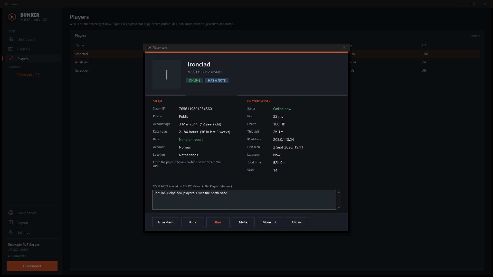

<div align="center">


### 🛡️ The desktop admin console for your **Rust** server
Watch the console, see who's online and run your server, without ever launching the game.

<br>

[](https://getbunker.app)
[](https://github.com/Russ773/Bunker-Windows/releases/latest)
[](https://github.com/Russ773/Bunker-Windows/releases)
[](https://github.com/Russ773/Bunker-Windows/actions)
[](#-download)
[](https://dotnet.microsoft.com/)

[](#-getting-started)
[](#-getting-started)
[](docs/WIDGETS.md)
[](#-screenshots)
[](#-safety--privacy)


<br>

**[🌐 getbunker.app](https://getbunker.app)** &nbsp;·&nbsp; **[⬇️ Download](#-download)** &nbsp;·&nbsp; **[✨ Features](#-features)** &nbsp;·&nbsp; **[🖼️ Screenshots](#-screenshots)** &nbsp;·&nbsp; **[🚀 Getting started](#-getting-started)** &nbsp;·&nbsp; **[🧩 Widgets](#-community-widgets)** &nbsp;·&nbsp; **[🛠️ Build](#-build-from-source)** &nbsp;·&nbsp; **[🗺️ Roadmap](#-roadmap)**

</div>

<br>


---

## ⬇️ Download

<div align="center">

[](https://github.com/Russ773/Bunker-Windows/releases/latest)

<a href="https://get.microsoft.com/installer/download/9pl3409lvh1r?referrer=appbadge"></a>

</div>

1. Grab **`Bunker-Setup-x.y.z.exe`** from the [latest release](https://github.com/Russ773/Bunker-Windows/releases/latest), or download the same installer from [getbunker.app](https://getbunker.app).
2. Run it. It installs just for you, with no admin prompt.
3. Start **Bunker** and enter your server's RCON details. That's it.

> 🛍️ **Easiest way: [get Bunker from the Microsoft Store](https://apps.microsoft.com/detail/9PL3409LVH1R)** (listed as **Bunker RCON**). It installs with no Windows warnings and the Store keeps it up to date.
>
> 💡 The installer above isn't code-signed, so Windows SmartScreen may say the publisher is unknown. Choose **More info → Run anyway**.
> If Windows 11's Smart App Control blocks it outright, right-click the downloaded file, open
> **Properties** and tick **Unblock** before running it.

---

## 🆕 What's new

Recent additions, newest ideas first:

* 👤 **Player cards.** Double-click a player on the Dashboard, Players page or Player database to open their card: their Steam profile (picture, account age, bans, and with a free Steam key their hours in Rust), how they are doing on your server (ping, health, IP address, time played and visits), your note about them, and buttons to give an item, kick, ban or mute, with teleport and more under **More**.
* 📤 **Share your widgets.** Made a widget? **Widgets → Get more widgets → Share a widget** checks it, lists every command it can send, and opens GitHub with the submission filled in. It is checked automatically, read by a person, and then appears in **Browse library** for everyone.
* 🗂️ **A roomier Widgets page.** **All widgets** in the sidebar opens every widget as a tile, grouped (Favourites, Built in, Community) with a search box. The sidebar no longer has a long list to scroll, and its spacing is tighter so it fits smaller screens.
* 💾 **Export.** **Save** in the Console header writes what you can see (search and filters applied) to a text file, and **Export CSV** on the Player database saves the players as a spreadsheet that opens in Excel, Google Sheets or LibreOffice. Files go to `Documents\Bunker\Exports` by default, so your other folders stay tidy.
* 📣 **What's new after an update.** The first time a new version runs, a short note lists what changed. It never shows on a fresh install, and you can open it again from **Settings → About**.
* 🚫 **Ban list as a table.** The Ban Manager widget now shows your bans as a sortable table (Steam ID, name, reason and when each ban ends, with expired ones marked). Click a row to fill in the Steam ID, then press Unban.
* 🌐 **Multi Server.** A **Multi Server** page above Layout shows up to **six** of your servers side by side, all the same size and filling the window: online or offline (and why), players, FPS, uptime, a player chart and who is on. Open any server with one click, or **say something or run a command on all online servers** in one go (you confirm first). Add a server from the page, and choose which six to show if you have more. Bunker only keeps these extra connections while the page is open.
* 👋 **A welcome screen that shows what is possible.** On first launch you can tick **I have more servers to add** and enter several in a row, and the screen shows how the Multi Server page looks.
* 🔔 **Tray icon and notifications.** A Bunker icon in the system tray (right-click to show, connect or quit). When Bunker is minimised or behind other windows, Windows tells you about chat watch-words and a lost connection. Everything is optional in **Settings → General**, including hiding Bunker from the taskbar when minimised.
* 🔌 **Auto-reconnect.** If the connection to your server drops (a restart, a wobble, your PC waking from sleep), Bunker keeps trying to get it back and tells you in the console. Click Connect or Disconnect to stop it, or turn it off in **Settings → General**.
* ❌ **The X asks first.** Clicking the X in the corner now asks whether to **minimise** Bunker (so it stays connected and your schedules keep running) or close it. Tick *Remember my choice* to stop being asked, and change it any time in **Settings → General**.
* 💬 **Chat as yourself.** Set a name, Steam ID and colour in **Settings → Chat** and your messages show in-game with your name and Steam picture instead of SERVER (needs the small [BunkerChat plugin](plugins/BunkerChat.cs)). The console box has a **Command / Chat** switch, and asks "say this in chat?" before sending ordinary words as a command.
* 🎨 **Chat looks like the game.** Coloured player names, a green **[TEAM]** tag, plugin prefixes such as **[ADMIN]** (colour set in Settings → Chat), and no more repeated names when a chat plugin adds its own.
* 🙈 **Hide console noise.** Hide a whole plugin (`[Economics]`, `[Steam Groups]`) or any line containing words you choose, from **Console → Filter** or by right-clicking a line.
* 🔎 **Item search with pictures.** Type "wood" in **Give items** (or the player menu) and get *Wood* with its picture. The list comes from the game's own files and updates itself when Rust does.
* 📋 **Plugin lists as a table.** Carbon and Oxide plugin lists show as a sortable table (versions, hook time, memory, uptime) with failed plugins listed underneath. Click a row to fill in the plugin name.
* ⭐ **Favourite widgets.** Click the ☆ on any widget tile to make it a favourite. Favourites are what the sidebar lists under WIDGETS, so it stays short. Right-click a tile to **hide** it (it stays in Layout, and a Hidden group on the Widgets page brings it back).
* 🔄 **Widget updates.** **Settings → Updates** now lists newer versions of your community widgets, and an orange dot marks them in the menu.
* 🖱️ **One right-click menu everywhere.** The Players page, the Dashboard and the **Player database** share the same menu: copy, Steam profile, kick, ban, mute, teleport, give item and notes.
* 📥 **Import servers from RustAdmin** (Settings → Servers → Import).
* 🧩 **A clearer split.** **Core** (Dashboard, Console, Players, Layout, Settings) and **Widgets** (everything optional) have their own headings in the sidebar.
* 🛡️ **Update checks no longer hit GitHub's rate limit**, and the app starts, connects and recovers more gracefully.

---

## ✨ Features

Bunker is split in two so it is always clear what is part of the app and what is an add-on.

### 🏠 Core: always there

| | |
| --- | --- |
| 🖥️ **Console** | The heart of Bunker. Colour-coded live output and a command box that runs **any** console command. Command history with ↑/↓, **search and filters** (hide chat, warnings, errors, **a whole plugin such as [Economics], or any line containing words you choose**), auto-scroll, and your choice of **font and size**. Chat appears the way it does in the game, and a **Command / Chat** switch lets you talk from the same box. |
| 📊 **Dashboard** | Live players, FPS, entities, uptime, memory and map, with the player list and console in one glance. |
| 👥 **Players** | Who's online with ping, time played and health. Right-click for copy, Steam profile, kick, ban, mute, teleport, give an item (with picture search), or a private note. The same menu works in the Dashboard and the Player database. |
| 🌐 **Multi Server** | Up to six servers on one page, equal cards that fill the window: status, players, FPS, uptime, a player chart and who is on for each, a one-click Open, and a box to send a message or command to every online server. |
| 🪟 **Layout** | Pick 1, 2 or 4 sections and put a core panel *or any widget* in each. Go **fullscreen** for a wall-display control room. |
| 💬 **Chat** | Send chat from Bunker with your own name, colour and Steam picture instead of SERVER (**Settings → Chat**). It needs the small [BunkerChat plugin](plugins/BunkerChat.cs) on the server (Carbon or Oxide); without it Bunker falls back to the plain `say` command with your name in the text. Messages from players show with their name colour, **[TEAM]** and plugin prefixes such as **[ADMIN]**. |
| ⚙️ **Settings** | Several saved servers (passwords encrypted for your Windows account), **import from RustAdmin**, dark and light themes, console font, your chat name and colours, startup options, what the X in the corner does (ask, minimise or close), and updates for both Bunker and your widgets that *ask first*. |

### 🧩 Widgets: optional add-ons

**All widgets** (under the WIDGETS heading in the sidebar) opens a page with every widget as a tile, grouped as Favourites, Built in and Community, with a search box. Click a tile to open the widget, with a live console beside it so you see the server's reply. **Add to Layout** puts any widget into a Layout section in one click. Click the **☆** on a tile to make it a favourite: favourites are listed in the sidebar, so the ones you use most are one click away. Right-click a tile to hide it; hidden widgets stay available in the Layout picker and wait in a Hidden group at the bottom of the page. An orange **Update available** marks a community widget that has a newer version (see **Settings → Updates**).

| | |
| --- | --- |
| **Built-in** · Announce, Quick actions, Moderation, Teleport, Shortcuts, Give items | One-click helpers for the things you do most. **Give items** has a searchable list of every current Rust item with its picture, kept up to date automatically when Rust updates. |
| **Built-in** · 📈 Server health | Live charts of FPS, players, entities and memory over 5 minutes to 2 hours. Spot lag spikes and restarts at a glance. |
| **Built-in** · ⏰ Scheduler | Recurring announcements, a daily world save, restart warning sequences with `wait` steps. |
| **Built-in** · 🗂️ Player database and Join/leave feed | Everyone who has joined, with **your own notes**, plus a live feed. Right-click anyone for the full player menu, even if they have left. |
| **Built-in** · 💬 Chat monitor | Watch-words that highlight messages and flash the taskbar, with mute, kick and ban from a message. |
| **Community** | Install widgets other people made. They can show live stats, command replies (plugin lists become a **sortable table**) and run timed sequences, and are reviewed command by command first. [Write your own →](docs/WIDGETS.md) |

---

## 🖼️ Screenshots

<table>
  <tr>
    <td colspan="2"><br><sub><b>🌐 Multi Server</b>: up to six servers at a glance, with one-click Open and send-to-all</sub></td>
  </tr>
  <tr>
    <td width="50%"><br><sub><b>🧩 Widgets</b>: every widget under its own heading in the sidebar</sub></td>
    <td width="50%"><br><sub><b>🪟 Layout</b>: put core panels or any widget in each section</sub></td>
  </tr>
  <tr>
    <td width="50%"><br><sub><b>📈 Server health</b>: live charts with a time window</sub></td>
    <td width="50%"><br><sub><b>🗂️ Player database</b>: history and your own notes</sub></td>
  </tr>
  <tr>
    <td width="50%"><br><sub><b>💬 Chat monitor</b>: watch-words and one-click actions</sub></td>
    <td width="50%"><br><sub><b>⏰ Scheduler</b>: announcements, saves and countdowns on a timer</sub></td>
  </tr>
  <tr>
    <td width="50%"><br><sub><b>🧩 Community widget</b>: live stats and replies, here the Server Report</sub></td>
    <td width="50%"><br><sub><b>☀️ Light theme</b>: one switch in Settings</sub></td>
  </tr>
  <tr>
    <td width="50%"><br><sub><b>📋 Plugin table</b>: sortable, with failed plugins listed underneath</sub></td>
    <td width="50%"><br><sub><b>🔎 Item search</b>: type "wood", pick it by picture</sub></td>
  </tr>
  <tr>
    <td width="50%"><br><sub><b>🚫 Ban list</b>: sortable, with expiry dates</sub></td>
    <td width="50%"><br><sub><b>🗂️ Widgets</b>: every widget as a tile, with search and favourites</sub></td>
  </tr>
  <tr>
    <td width="50%"><br><sub><b>👤 Player card</b>: double-click a player for Steam details, stats and actions</sub></td>
    <td width="50%"></td>
  </tr>
</table>

---

## 🚀 Getting started

### 1. Turn on WebRCON on your Rust server

Add these to your server's startup parameters, then restart it:

```text
+rcon.web 1 +rcon.port 28016 +rcon.password "choose-a-strong-password"
```

Make sure the RCON port (`28016` here) is reachable from your PC. On a hosted server that usually means opening it in the firewall.

### 2. Connect

Start Bunker. The welcome screen asks for:

| Field | Example |
| --- | --- |
| Server name | `My Rust Server` (optional) |
| Server address | `123.45.67.89` or `play.example.com` |
| RCON port | `28016` |
| RCON password | the one you set above |

Press **Test & connect**. Bunker checks the connection before saving anything. Offline right now? Choose **Save without testing**.

### 3. Optional: chat as yourself

To send chat with your own name and Steam picture, copy **BunkerChat.cs** (a button in **Settings → Chat**, or [from here](plugins/BunkerChat.cs)) into your server's `carbon/plugins` (Carbon) or `oxide/plugins` (Oxide) folder. It adds one admin-only command, `bunker.say`, and loads by itself. Bunker works fine without it.

### 4. Explore

* **Core** (Dashboard, Console, Players) is the app itself. The **Console** is where you read the server and run any command.
* **Widgets** holds the optional add-ons: announcements, moderation, charts, the scheduler and anything you install. **Layout** lets you build your own screen from core panels and widgets.
* Click the server name in the sidebar to switch servers. **Settings** has themes, fonts, startup options and updates.

> ⌨️ **Tips:** `↑`/`↓` recall previous commands · `Esc` or `F11` leaves fullscreen · right-click a player for quick actions · right-click a console line to hide that plugin · star the widgets you use most · hover long names for a tooltip.

---

## 🧩 Community widgets

A **widget** is a small `.json` file, **never a program**. It describes some fields and buttons, and lists every console command each button can send:

```json
{
  "id": "resource-drop",
  "name": "Resource Drop",
  "description": "Reward everyone online with a resource.",
  "controls": [
    { "type": "choice", "id": "item", "label": "Resource", "options": ["wood", "stones", "scrap"] },
    { "type": "number", "id": "amount", "label": "Amount each", "default": 500, "min": 1, "max": 5000 },
    {
      "type": "button",
      "text": "Give to everyone",
      "confirm": "Give {amount} x {item} to EVERY player?",
      "commands": [ "inventory.giveall {item} {amount}", "say \"Everyone just received {amount} {item}!\"" ]
    }
  ]
}
```

* 🔍 **Reviewed before install.** Bunker lists *every* command a widget can send, and marks risky ones (kick, ban, restart, give-to-everyone…) with `!`.
* 🚫 **Hard limits.** Widgets can't touch RCON settings or admin rights, can't run scripts and can't reach the network.
* 🧼 **Cleaned inputs.** Text typed into a widget has quotes, semicolons and control characters removed before it's used.
* ⚡ **More than buttons.** Widgets can show **live server stats**, display the server's **replies** in a panel (a Carbon or Oxide plugin list becomes a **sortable table**), and run **timed sequences** with a Stop button, such as countdowns.
* 📚 **Try the starters** in [`widgets/`](widgets): *Welcome Packs*, *Broadcast Presets*, *Resource Drop*, *Event Countdown*, *Server Report*, *Ban Manager*, *Oxide Plugin Control* and *Carbon Plugin Control*. Install them from **Widgets → Get more widgets → Browse library**.

Want to make one? Read the **[widget guide](docs/WIDGETS.md)** and open a pull request. 💜

---

## 🔒 Safety & privacy

* 🔐 **RCON passwords are encrypted** with Windows DPAPI, so only your Windows account can read them.
* 📡 Bunker talks to **your server** and to **GitHub** (to check for updates to Bunker and your widgets, the Rust item list and pictures, and, if you open it, the widget library). When you open a player card it also asks **Steam** for that player's public profile (only their Steam ID is sent; switch it off in **Settings → General**). The Rust item list and pictures come from [bobosneefdev/rust-items-json](https://github.com/bobosneefdev/rust-items-json) on GitHub, at most once a day, and can be switched off in **Settings → General**. Nothing else, and no analytics.
* 🙋 **Updates always ask first.** Nothing installs without your OK, and a widget update shows you everything it can do before it replaces the old one.
* 🧹 **Uninstalling removes everything.** The uninstaller deletes the program and, when you say yes, all the data Bunker saved (servers and their encrypted passwords, player notes, schedules, widgets and item pictures, all kept in `%APPDATA%Bunker`). A silent uninstall removes it all without asking. The Microsoft Store version is removed by Windows in the usual way.
* 🧪 The widget safety rules have **automated tests** that run on every release.

---

## 📟 Rust commands Bunker uses

| Feature | Commands |
| --- | --- |
| Live data | `serverinfo`, `playerlist` |
| Chat & announcements | `say`, and `bunker.say` (from the optional [BunkerChat plugin](plugins/BunkerChat.cs)) |
| Quick actions | `server.save`, `env.time`, `restart` |
| Moderation | `kick`, `banid`, `unban`, `mute`, `unmute`, `server.writecfg` |
| Teleport | `teleport` |
| Give items | `inventory.giveto`, `inventory.giveall` |
| Plugin control (widgets) | Carbon: `c.plugins`, `c.reload`, `c.load`, `c.unload` · Oxide: `oxide.plugins`, `oxide.reload`, `oxide.load`, `oxide.unload` |

> ℹ️ Command syntax follows public Rust admin references and can differ between server versions or plugins. The server's reply always appears in the console, so you can see exactly what happened.

---

## 🛠️ Build from source

You need Windows and the [.NET 10 SDK](https://dotnet.microsoft.com/download).

```bash
git clone https://github.com/Russ773/Bunker-Windows.git
cd Bunker-Windows

dotnet run --project src          # run it
dotnet test tests/Bunker.Tests    # run the tests
```

<details>
<summary><b>📁 Project layout</b></summary>

```text
Bunker-Windows/
├── src/                  The WinForms app (C#, .NET 10)
│   ├── Core.cs             connection, console log, server monitor
│   ├── RconClient.cs       WebRCON client
│   ├── *Page.cs            Dashboard, Console, Players, Widgets, Layout, Settings
│   ├── *View.cs            panels and widgets: console, players, charts, scheduler, player database, chat monitor, admin helpers
│   └── CommunityWidgets.cs the safe widget format, rules and store
├── tests/Bunker.Tests/   xUnit tests (widget rules, plugin lists, chat, item search, filters)
├── plugins/              BunkerChat.cs, the optional server plugin for chat as yourself
├── widgets/              starter community widgets
├── docs/                 widget guide and screenshots
├── installer/            Inno Setup script and wizard artwork
├── assets/               logo and icon sources
└── .github/workflows/    CI, release and upload pipelines
```

</details>

<details>
<summary><b>🚢 How a release works</b></summary>

Pushing a tag such as `v1.0.0` runs the pipeline:

1. 🧪 run the tests
2. 🏗️ publish a self-contained Windows build
3. 📦 build the Inno Setup installer and a Microsoft Store package
4. 🚀 publish a GitHub Release and upload the installer to the download site

</details>

---

## 🗺️ Roadmap

- [x] Live dashboard, console and player list
- [x] Admin tools: announce, quick actions, moderation, teleport, give items, shortcuts
- [x] Custom layouts and fullscreen mode
- [x] Multiple saved servers
- [x] Dark and light themes, console font and size
- [x] Community widgets with safe, reviewable commands, live stats, replies and timed steps
- [x] Server health charts, scheduler, player database and chat monitor
- [x] Console search and filters, and hiding plugins or words
- [x] Import servers from RustAdmin
- [x] Searchable Rust item list with pictures, kept current automatically
- [x] Chat as yourself, and chat that looks like the game
- [x] Plugin lists (Carbon and Oxide) as a sortable table
- [x] Favourite and hidden widgets, widget updates, and a tile page for all widgets
- [x] Auto-reconnect when the connection drops mid-session
- [x] Ban list as a proper table
- [x] Multi-server overview
- [x] Widget library submissions through the app
- [x] Microsoft Store listing
- [x] Android app (in testing, Google Play release planned)

Have an idea? [Open an issue](https://github.com/Russ773/Bunker-Windows/issues) or build a [widget](docs/WIDGETS.md).

---

## 🙏 Credits

* **Rust item list and pictures:** [bobosneefdev/rust-items-json](https://github.com/bobosneefdev/rust-items-json), which re-reads the game files whenever Rust updates. The item data and pictures belong to Facepunch Studios; Bunker is not affiliated with or endorsed by them.
* **[SkiaSharp](https://github.com/mono/SkiaSharp)** (MIT) turns those pictures into something Windows can draw.

---

## 🤝 Contributing

Pull requests are welcome (under the [MIT License](LICENSE)), especially **widgets** (add a `.json` file to [`widgets/`](widgets) and list it in `widgets/index.json`) and bug reports with the steps to reproduce them. Please run `dotnet test tests/Bunker.Tests` before you open a PR.

---

<div align="center">

<sub>Website: [getbunker.app](https://getbunker.app) &nbsp;·&nbsp; Released under the [MIT License](LICENSE).</sub>

<sub>Bunker is an independent community tool. **Rust** is a trademark of Facepunch Studios; Bunker is not affiliated with or endorsed by Facepunch. Microsoft, Windows and the Microsoft Store are trademarks of the Microsoft group of companies; Bunker is not affiliated with or endorsed by Microsoft.</sub>

<br>


</div>
